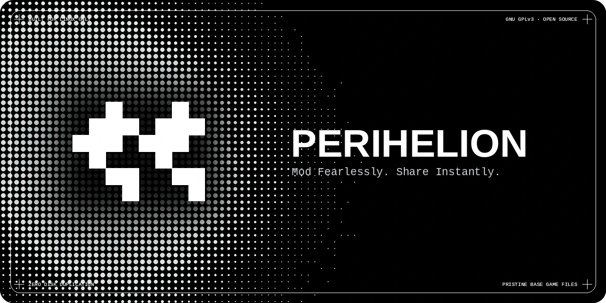

# Perihelion

<div align="center">
  
  <p>
    <em>No 40-step installation guides. No throttled 2 MB/s download caps.<br/>
    Perihelion turns entire modded setups into lightweight, shareable blueprints you can sync and play in one command.</em>
  </p>
</div>

---

## What Perihelion Enables

Traditional game modding on Linux has long been a fragile chore of manual file extraction, corrupted game directories, conflicting overwrites, and painfully slow download speeds. 

Perihelion fundamentally re-imagines modding from **file mutation** to **declarative virtualization**:

- ⚡ **Play in One Command:** Turn a 400-mod setup into a lightweight, declarative blueprint (`peri.lock`). Clone a link, sync dependencies, and boot directly into the game.
- 🛡️ **Pristine Base Game Files:** Your vanilla installation is mounted strictly read-only. Mods exist as isolated, virtual layers composed on the fly—zero file overwriting, zero leftover clutter, zero risk of reinstalling.
- 🚀 **Uncapped Swarm Streaming:** Distributed P2P BitTorrent streaming (`.peca`) delivers multi-gigabyte overhauls at the true line-speed of your connection—no throttled caps, no paywalled downloads.
- 🔄 **Instant Profile Switching:** Swap between a lightweight *Vanilla+* playthrough and a total overhaul build in milliseconds without re-copying or re-deploying hundreds of gigabytes.
- 🎮 **Proton & Steam Native:** Built from day one for modern Linux gaming, Steam Deck, and Proton prefixes.

---

## Engineered Differently (Under the Hood)

Perihelion separates the functional domain from system operations through a strict **"Functional Core, Imperative Shell"** architecture:

```text
perihelion/
├── apps/
│   ├── peri/             # High-speed CLI shell (clap, miette, tokio)
│   ├── perid/            # Official background seeding & orchestration daemon
│   └── helion/           # Terminal-native interactive TUI dashboard (ratatui, crossterm)
├── crates/
│   ├── peri-vfs/         # Adapter: Linux OverlayFS & unprivileged namespaces (nix)
│   ├── peri-archive/     # Adapter: .peca archives (tar, multi-threaded zstd)
│   └── peri-net/         # Adapter: P2P BitTorrent (librqbit) & HTTP streaming (reqwest)
└── common/
    └── peri-core/        # Pure Domain: manifests, DAG solver, VFI, game profiles
```

### The Technical Marvel

| Technology | How It Works | Why It Matters |
| :--- | :--- | :--- |
| **Kernel OverlayFS** | Stacks mod directories (`lowerdir`) in kernel memory over an untouched base game. | Instant virtual composition with **zero physical disk duplication**. |
| **Unprivileged Namespaces** | Combines `CLONE_NEWNS` and `CLONE_NEWUSER` to create isolated mount tables per game. | Complete filesystem sandbox **without requiring root or sudo**. |
| **The `.peca` Standard** | Multi-threaded Zstandard-compressed tarballs (`.tar.zst`) with a root `peri.toml` manifest. | Inspect manifests and file indices in milliseconds **without decompressing to disk**. |
| **3-Tier DAG Waterfall** | PubGrub-inspired resolution solver using explicit edges $\to$ priority weights $\to$ hard conflicts. | **Deterministic, reproducible mod order** that eliminates mysterious load-order crashes. |

---

## Tools in the Suite

### 1. `helion` — The Interactive TUI Dashboard
A fast, keyboard-first terminal dashboard inspired by modern developer tools like Warp and Claude Code:
- **Centered Start Overview:** Live project telemetry, quick stats, and instant game switching.
- **Smart Command Palette:** Inline autocomplete ghost text (`[Tab]` to complete) for commands, mod names, and profiles.
- **3-Tier Conflict Resolver:** Side-by-side visual file collision inspector with 1-key resolution.
- **P2P Swarm Queue:** Real-time swarm telemetry, peer health indicators, and transfer metrics.

Run `helion` with:
```bash
cargo run -p helion
```

### 2. `peri` — The Headless CLI
A high-performance command-line utility for scripting, headless installations, and automated CI pipelines:

```bash
# Initialize a workspace for Skyrim Special Edition
peri init skyrim_se

# Fetch and cache a mod package or overhaul
peri get https://mods.perihelion.io/profiles/requiem-overhaul.peca

# Solve dependency DAG and sync all virtual layers
peri sync

# Spawn unprivileged mount namespace and run the game
peri run
```

#### CLI Command Reference

| Command | Action |
| :--- | :--- |
| `peri init <game_id>` | Initializes a Perihelion workspace mapped to a target game profile |
| `peri get <uri>` | Fetches a package via HTTP or BitTorrent and registers it in cache |
| `peri sync` | Solves dependency graph, verifies hashes, and prepares VFS layers |
| `peri package <dir>` | Compiles a local mod folder into a validated `.peca` archive |
| `peri check` | Runs global dependency DAG checks and validates file integrity |
| `peri run` | Spawns the isolated namespace, mounts OverlayFS, and launches the game |
| `peri config` | Inspects or edits global configuration (`~/.config/perihelion/config.toml`) |

### 3. `perid` — The Official Background Daemon
A lightweight, low-overhead background daemon that powers P2P BitTorrent swarm seeding and package availability across the community:
- **Autonomous Swarm Seeding:** Monitors the `.perihelion/cache` repository and automatically seeds `.peca` packages over the BitTorrent DHT network.
- **Configurable Rate Limits:** Respects user bandwidth policies configured in `~/.config/perihelion/config.toml` or via CLI flags (`--upload-limit`).
- **Graceful Lifecycle Management:** Designed to run seamlessly in user space or as a `systemd --user` service unit.

Run `perid` with:
```bash
cargo run -p perid -- --help
```

---

## Declarative Layout Mappings

Rather than hardcoding mod installation folders or mutating local files, Perihelion's domain core (`common/peri-core`) uses a declarative `LayoutMapping` model. Each profile specifies how package prefixes map to target VFS destinations (e.g. `Data/*` $\to$ `Data/*` or `archive/*` $\to$ `archive/*`) so OverlayFS can stack layers cleanly.

> [!NOTE]
> **Active Development Status:** Multi-game profile automation, dynamic Steam library detection, and script extender launcher hooks are currently in active development. Profile views and game cards in `helion` serve as UI and layout architecture prototypes while the engine is being built.

---

## Development & Verification

Perihelion enforces a strict zero-warning policy across all targets:

```bash
# 1. Run all workspace unit tests
cargo test --workspace

# 2. Strict clippy linting
cargo clippy --workspace --all-targets -- -D warnings

# 3. Formatting check
cargo fmt --all --check

# 4. CLI Sanity check
cargo run -p peri -- --help

# 5. Background daemon sanity check
cargo run -p perid -- --help

# 6. Helion TUI Sanity check
cargo run -p helion
```

For full details on architecture, toolchain, and contribution standards, see [`CONTRIBUTING.md`](./CONTRIBUTING.md).

---

## Community & Policies

- 🤝 **[Contributing Guidelines](./CONTRIBUTING.md):** Architectural invariants, developer workflows, and PR standards.
- 🏷️ **[Project Naming & Authenticity Policy](./TRADEMARK.md):** Guidelines for forks, distributions, and preventing impersonation.
- 🛡️ **[Security Policy](./SECURITY.md):** Responsible disclosure process and threat model.
- 📜 **[Code of Conduct](./CODE_OF_CONDUCT.md):** Community standards and pledge.

---

## License

Perihelion uses a split-licensing model:

- 💻 **Software & Codebase:** Licensed under the [GNU General Public License v3.0 (GPL-3.0-or-later)](./LICENSE).
- 🎨 **Visual Assets & Media:** All branding, banners, and vector artwork in [`assets/`](./assets) are licensed under the [Creative Commons Attribution 4.0 International (CC BY 4.0)](./LICENSE-CC-BY-4.0).

<br/>

<div align="center">
  <a href="./LICENSE">
    
  </a>
  <p>
    Software licensed under <strong>GPL-3.0-or-later</strong> &bull; Visual assets licensed under <strong>CC-BY-4.0</strong>
  </p>
</div>


