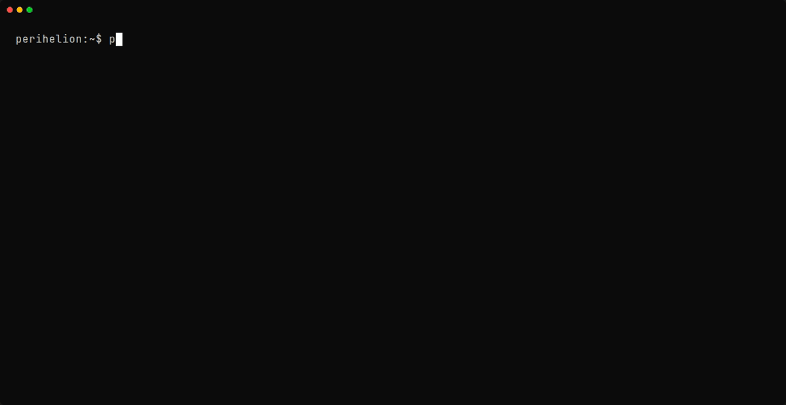
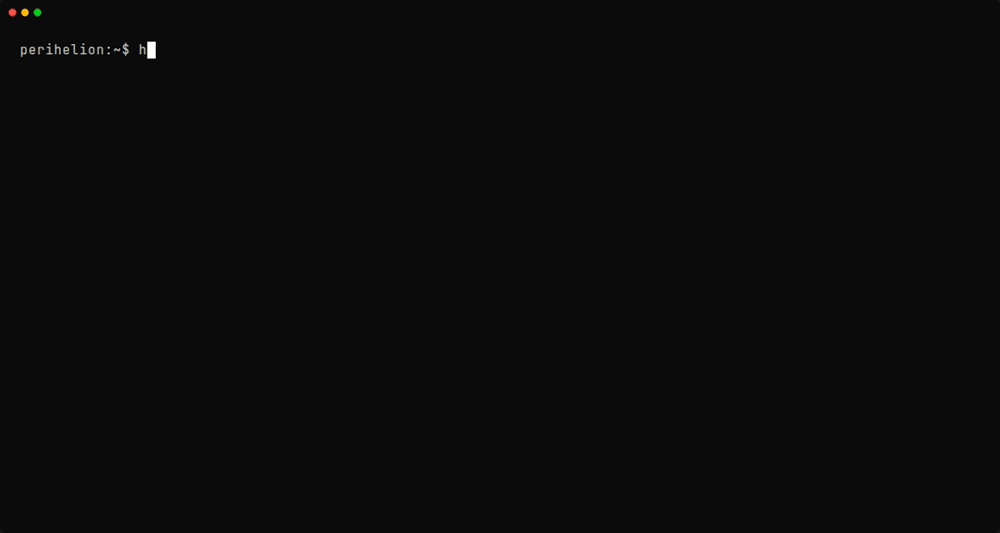

# perihelion (Binaries)

Executable applications and runtime shells for the Perihelion ecosystem.

This crate produces three binaries:
- [`peri`](#peri-the-cli-shell): Core command-line manager and VFS runner.
- [`perid`](#perid-the-background-seeder): Background P2P seeding daemon.
- [`helion`](#helion-the-tui-dashboard): Interactive terminal dashboard.

---

## `peri`: The CLI Shell

The command-line interface for headless mod management, continuous integration checks, and isolated game launching.



### Subcommands

```text
peri <COMMAND> [OPTIONS]
```

| Command | Description |
| :--- | :--- |
| `init <game_id>` | Initializes a new Perihelion workspace with a starter `peri.toml` mapped to a target game profile (e.g. `cyberpunk_2077`, `starfield`, `generic`). |
| `get <uri>` | Downloads a `.peca` package via HTTP URL, BitTorrent magnet link, or local path into the VFS package cache. |
| `sync` | Resolves the dependency graph, verifies checksums, unpacks missing archives, and writes `peri.lock`. |
| `package [dir]` | Compiles a mod folder containing a root `peri.toml` into a validated `.peca` archive with multi-threaded Zstandard compression. |
| `check` | Scans workspace manifests for dependency cycles, missing packages, and unresolved file collisions. |
| `run` | Mounts the OverlayFS stack inside an unprivileged Linux mount namespace and executes the game binary. |
| `config` | Displays or edits global settings (`~/.config/perihelion/config.toml`). |

### Common Workflows

#### 1. Initializing a Workspace
```bash
peri init cyberpunk_2077 --name "night-city-overhaul"
```
Creates `peri.toml` preconfigured for Cyberpunk 2077 layout rules.

#### 2. Pulling and Syncing Mods
```bash
# Fetch a mod archive via magnet link or direct URL
peri get "magnet:?xt=urn:btih:e3b0c44298fc1c149afbf4c8996fb92427ae41e4649b934ca495991b7852b855&dn=core_tweaks.peca"

# Resolve dependencies and unpack missing layers
peri sync
```

#### 3. Launching Sandboxed
```bash
# Launch game inside ephemeral OverlayFS namespace
peri run

# Simulate mount options without entering namespaces (dry run)
peri run --dry-run
```

---

## `perid`: The Background Seeder

A lightweight daemon that seeds `.peca` archives back to the P2P swarm directly from the local cache.

### Configuration & CLI Flags

```bash
perid --cache-dir ~/.config/perihelion/cache/mods --upload-limit 500
```

- `--cache-dir <PATH>`: Custom directory path containing `.peca` archives to seed.
- `--upload-limit <KBS>`: Bandwidth throttle in KB/s (`0` for uncapped upstream).
- `-v, --verbose`: Enables detailed swarm connection tracing.

### Systemd User Unit

To run `perid` continuously as a background systemd user service, install the template unit from `scripts/perid.service`:

```bash
mkdir -p ~/.config/systemd/user
cp scripts/perid.service ~/.config/systemd/user/
systemctl --user daemon-reload
systemctl --user enable --now perid.service
```

---

## `helion`: The TUI Dashboard

Terminal user interface launcher. It hooks terminal panics to restore raw mode cleanly on exit, then hands control over to the interactive event loop.



```bash
# Launch interactive TUI in current workspace
helion
```
